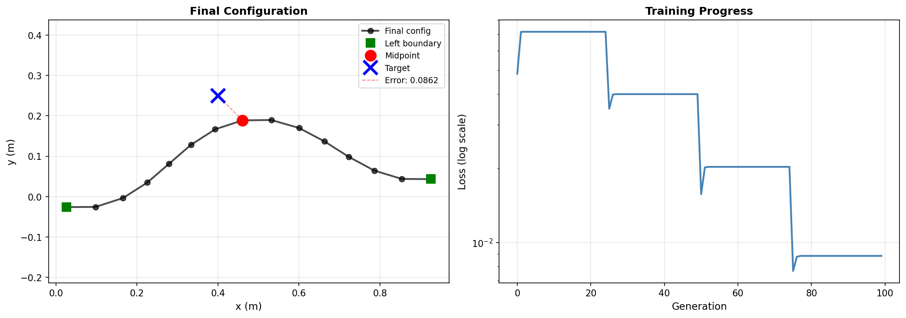

# Neural Control

A minimal, self-contained implementation of **Neural Control**, a method for
controlling deformable linear objects (DLOs, e.g. elastic rods/strips) whose
state is defined *implicitly* by an equilibrium condition (`G(x, z) = 0`)
rather than an explicit forward dynamics model.

This branch (`neural-control-core`) contains only the core method: the
equilibrium simulator, the adjoint gradient tools, and one training script per
task — the paper's point-to-point and trajectory-tracking tasks, plus pipe
insertion. All three are the same adjoint neural control under different
losses.

## How it works

Instead of unrolling the Newton-Raphson equilibrium solver to get gradients
(expensive), Neural Control differentiates the equilibrium condition itself
at the converged solution ("implicit adjoint" gradients), then trains a
boundary-actuation controller with those gradients:

1. **`src/SimulatorEnv_2D.py` / `src/SimulatorEnv_3D.py`** — simulate the rod
   by solving for its equilibrium at each timestep, warm-started from the
   previous step so the solver stays on one equilibrium branch instead of
   jumping between them. Pick one with `env.dim` in the config (see
   [2D vs. 3D](#2d-vs-3d)).
2. **`src/implicit_grad_tools.py`** — computes the adjoint gradient of the
   loss w.r.t. the controls, chaining the per-step equilibrium sensitivities
   across the whole horizon (`multistep_adjoint_gradient()`).
   `train.grad_method` picks how: `state` (exact, the default) or `proxy`
   (frozen tangent); see
   [Adjoint gradient: state or proxy](#adjoint-gradient-state-or-proxy).
3. **`src/neural_control.py`** — the controller and the training step, shared
   by all three task scripts: an MLP maps a continuation parameter
   `λ ∈ [0, 1]` (progress through the control horizon) to boundary actuation
   rates, the rates are integrated into commands, and the adjoint gradient is
   handed to autograd as a surrogate, attached to the commands (`state`) or
   to the rates (`proxy`). The three tasks differ only in their loss.
4. **Receding-horizon control (RHC)** — optional (`rhc.enabled` in
   `configs/default.yaml`). Splits the horizon into shorter segments,
   optimized and committed one at a time, warm-started from the previous
   segment's end state. Bounds error accumulation over long horizons.
5. **Global planning first** — optional (`--method rrt_nc`). An RRT on a
   coarse rod (`src/dlo_rrt.py`) finds a feasible path, the policy is fitted
   to it, and the same training refines it. Point-to-point and tracking both
   offer it, with a `report` command that compares the two starts.

## Repository layout

```
neural-control/
├── configs/
│   ├── default.yaml            # Global config: rod/task/start pose/RHC/training params
│   ├── example_3d.yaml         # Minimal 3D override (and example_3d_twist.yaml, with torsion)
│   ├── task_90deg_pipe.yaml    # The pipe task
│   └── workspace_3d.yaml       # Gripper workspace variants (and no_workspace.yaml)
├── src/
│   ├── SimulatorEnv_2D.py      # Equilibrium (Newton-Raphson) rod simulator, 2D
│   ├── SimulatorEnv_3D.py      # Equilibrium (Newton-Raphson) rod simulator, 3D
│   ├── newton.py               # The globalized Newton solve both simulators share
│   ├── energy.py               # Pluggable elastic-energy models (der, der3d, der3d_twist)
│   ├── rodframes.py            # Bishop frame + twist holonomy (torsion)
│   ├── contact.py              # Penalty-based obstacle contact forces (Circle/Sphere/pipe)
│   ├── implicit_grad_tools.py  # Adjoint / implicit-gradient computation (2D and 3D)
│   ├── neural_control.py       # The controller, the rollout and the adjoint update
│   ├── dlo_rrt.py              # RRT on a coarse rod, for the global-planning start
│   ├── env_factory.py          # dim-aware env/control/target construction
│   ├── config.py               # YAML config loader (deep-merges onto configs/default.yaml)
│   ├── blas_threads.py         # Pins BLAS to one thread (see Performance)
│   ├── compute_audit.py        # Redundancy audit: how much inner-loop work is a repeat
│   ├── runlog.py               # Per-run training log (JSONL + TensorBoard)
│   ├── render_neurips.py       # DLO rendering utilities (2D)
│   └── utils.py                # Result visualization
├── scripts/
│   ├── train_point_to_point.py # Task 1: the mid node reaches a target
│   ├── train_tracking.py       # Task 2: the mid node follows a path
│   ├── train_pipe.py           # Task 3: a free tip is pushed through a 90-degree pipe
│   ├── check_twist.py          # Finite-difference validation of the torsion model
│   ├── check_pipe_contact.py   # Finite-difference validation of the pipe contact model
│   ├── check_grad_method.py    # The two adjoint gradients vs finite differences / by hand
│   ├── snapshot_overlay.py     # Multi-frame DLO configuration visualization
│   └── test_gpu.py             # MPS/GPU availability check
├── img/                        # README figures
└── experiments/                # Created at runtime: one directory per run
    └── <experiment_name>/runs/<timestamp>-<job>/
        ├── config.yaml, meta.json, log.jsonl, summary.json
        ├── <job>.json / <job>.npz        # the run's record, for `report`
        ├── neural_control_result.png     # final shape + loss curve
        └── neural_control_animation.gif  # rollout animation (output.save_gif: true)
```

## Choosing a rod material

`configs/default.yaml` carries a `materials:` registry of cross-section /
material presets; `rod.material` picks one:

| preset | EI (1 m rod) | ν | GJ (twist) | notes |
|---|---|---|---|---|
| `steel_tube` | 2.19e+3 N·m² | 0.30 | 1.68e+3 N·m² | stiff extreme, slow solves |
| `aluminum_tube` | 7.65e+2 N·m² | 0.33 | 5.75e+2 N·m² | the original default |
| `soft_strip` | 1.27e-1 N·m² | 0.40 | 9.09e-2 N·m² | thin polymer strip — fast, visibly deforms |
| `silicone_cord` | 2.45e-3 N·m² | 0.49 | 1.65e-3 N·m² | cable-like, gravity-dominated |

```yaml
rod:
  material: soft_strip
```

A preset sets `R_outer`, `r_inner`, `E_al`, `rho_al` and `poisson`; everything
else (I, A, EI, EA, GJ, nodal mass) is derived from those. Any of them can
still be overridden directly under `rod:`, which wins over the preset:

```yaml
rod:
  material: aluminum_tube
  r_inner: 0.012       # same material, thinner wall
```

`poisson` is only used when `rod.twist` is on: for the circular cross-section
`J = 2I` and `G = E / (2(1+ν))`, so the torsional stiffness is
**`GJ = EI / (1 + ν)`**. It is a property of the material rather than a solver
setting, which is why it lives in the preset — aluminium, nylon, steel and
silicone genuinely differ, and the resulting `GJ/EI` ranges from 0.67
(silicone) to 0.77 (steel). Omitting it defaults to 0.3.

Use `material: custom` to skip the presets and give the four required fields
yourself (`poisson` stays optional). To add a preset, append an entry under
`materials:` and point `rod.material` at it. Each run prints the resolved
material and its EI/EA, plus GJ when twist is on.

Note that EI scales with the *fourth* power of the radius, so the cross-section
usually matters more than the material. A stiff rod barely deforms under the
boundary control and its Newton solve needs many more line-search steps —
`soft_strip` is the fastest preset to iterate with.

## Setup

```bash
conda env create -f requirement.yml
conda activate neural-control
```

or install directly with pip: `numpy`, `matplotlib`, `tqdm`, `torch`,
`tensorboard`, `pyyaml`.

## Configuration

All three training scripts are driven by a single YAML config,
[`configs/default.yaml`](configs/default.yaml). Edit it directly, or pass
`--config path/to/your.yaml` with a file that only overrides the fields you
care about (deep-merged onto the defaults). Key sections:

**The script decides the task, not the config.** `train_point_to_point.py`
always does point-to-point, `train_tracking.py` always does tracking,
`train_pipe.py` always does the pipe. Each prints which one it is at startup.
`task.target_*` is shared — point-to-point drives the mid node there, and the
default tracking path ends there — while keys only one task reads are nested
under it (`task.tracking:`, `task.pipe:`).

A user config may only set keys `configs/default.yaml` defines; anything else
raises, with the nearest defined key suggested:

```
configs/mine.yaml sets keys that configs/default.yaml does not define:
  - rod.nvv (did you mean 'rod.nv'?)
```

Silently ignoring a stray key is how a run ends up not doing what its config
appears to say. (`materials:` and `energy.params:` are open-ended and exempt.)

Key sections:

- `env` — `dim: 2` or `dim: 3`, i.e. which simulator to use
- `rod` — physical/geometric parameters (node count, timestep, horizon, material,
  and `gravity` in 3D)
- `energy` — elastic energy model (built-in DER, or your own; see `src/energy.py`)
- `start` — initial boundary pose for both rod ends
- `task` — the target, and under `task.tracking:` the path for tracking runs
- `newton` — equilibrium-solver safeguards (line search, regularization); see
  [Newton convergence](#newton-convergence)
- `rhc` — whether to use receding-horizon control, segment count, re-init policy
- `train` — epochs, learning rate, network width, seed, device

## 2D vs. 3D

Set `env.dim` in the config; all three training scripts, the adjoint
gradients, contact, and the plots follow it.

|                     | `dim: 2`                 | `dim: 3`                       | `dim: 3` + `rod.twist`                |
| ------------------- | ------------------------ | ------------------------------ | ------------------------------------- |
| simulator           | `SimulatorEnv_2D`        | `SimulatorEnv_3D`              | `SimulatorEnv_3D`                     |
| DOFs                | `2·nv`                   | `3·nv`                         | `3·nv + 2` (+ the two gripper yaws)   |
| control per rod end | `(x, y, θ)`              | `(x, y, z, θ, φ)`              | `(x, y, z, θ, φ, yaw)`                |
| full control vector | 6D                       | 10D                            | 12D                                   |
| elastic energy      | `der`                    | `der3d`                        | `der3d_twist`                         |
| obstacles           | `CircleObstacle`         | `SphereObstacle`               | `SphereObstacle`                      |
| gravity             | −y (hardcoded)           | `rod.gravity`, default −z      | `rod.gravity`, default −z             |
| target / trajectory | `task.target_xy`         | `task.target_xyz`              | `task.target_xyz`                     |
| initial end poses   | `start.u_left`/`u_right` | `start.u_left_3d`/`u_right_3d` | `start.u_left_twist`/`u_right_twist`  |

Both rod ends are **clamped**: the control prescribes each end's position and
its tangent direction. In 3D the tangent needs two angles instead of one —
azimuth `θ` in the x-y plane and elevation `φ` out of it:

```
d(θ, φ) = ( cos φ · cos θ,  cos φ · sin θ,  sin φ )
```

so `φ = 0` reproduces the 2D convention exactly. The two clamped nodes at each
end are `node_0 = p_l`, `node_1 = p_l + ΔL·d(θ_l, φ_l)` and symmetrically at the
right end.

The 3D elastic energy (`der3d` in `src/energy.py`) is the Discrete Elastic Rod
model for a naturally straight rod: per-edge stretching springs plus isotropic
bending `E_b = Σ (EI / 2ΔL)·|κb|²`. Because the rod is naturally straight and
bending is isotropic, `|κb|²` reduces to a function of the single scalar
`c = t_e · t_f`, which is what makes the *exact* Hessian — required by the
adjoint gradient — cheap to write in closed form.

Torsion is off by default and enabled with `rod.twist: true`; see
[Torsion and gripper yaw](#torsion-and-gripper-yaw).

### Which way is down

**3D uses z-up**: `rod.gravity` defaults to `[0, 0, -9.81]`, the convention a
real manipulator works in. **2D has gravity along −y**, hardcoded, because a
2D rod has no third axis to put it on. So the two are genuinely different
physical setups, not the same one at different dimensions.

That matters for the tracking curves. `circle`, `figure8` and `line` are meant
to stand up in the *vertical* plane — a circle centred above the rod is a lift
against gravity, not a horizontal sweep — so they follow whichever axis gravity
is on: **x-y in 2D, x-z in 3D**. Their in-plane coordinates are identical
between the two (verified exactly), only the plane differs. `segment` (the
default, see [Tracking targets](#tracking-targets)) and the named presets of
`train_tracking.py` are anchored to the rod rather than to an axis, so the
convention does not affect them.

If you want the two simulators to agree node for node — useful for
cross-checking them — set

```yaml
rod:
  gravity: [0.0, -9.81, 0.0]    # put 3D's gravity back on 2D's axis
```

A 3D run confined to `z = 0` with `φ = 0` then reproduces the 2D run to ~1e-17.
Under the z-up default they differ, as they should: the rod sags along a
different axis. `make_target_trajectory(..., up_axis=...)` overrides the curve
plane if you tilt gravity somewhere else again.

`scripts/snapshot_overlay.py` and `src/render_neurips.py` remain 2D-only.

## Performance

The dominant per-step cost is the dense solve `J_ff \ f_free`, where
`n_free = dim*nv - 4*dim` — **94** for the 2D default (nv=51) and **141** for
the 3D one. That 1.5x growth in DOFs is not what makes 3D slow. OpenBLAS
switches from its serial kernel to a threaded one at about n = 100, and for
matrices this small the thread spawn/sync overhead dwarfs the factorization.
Measured on a 16-core machine:

| solve size | default threads | `OPENBLAS_NUM_THREADS=1` |
| ---------- | --------------- | ------------------------ |
| 94 x 94 (2D default)  | 0.057 ms   | 0.057 ms |
| 100 x 100             | **96.4 ms**| 0.063 ms |
| 141 x 141 (3D default)| **260.8 ms**| 0.127 ms |
| 256 x 256             | 604.8 ms   | 0.615 ms |

2D lands just under the threshold and 3D just over it, so 3D paid a ~2000x
penalty on its single hottest operation. The training scripts therefore call
`limit_blas_threads()` ([`src/blas_threads.py`](src/blas_threads.py)) before
importing NumPy. Real effect, 2 epochs of the default 3D config
(nv=51, N=200): **396 s -> 22 s, ~18x**.

The variables are set with `setdefault`, so the shell always wins if you want
something else:

```bash
OPENBLAS_NUM_THREADS=4 python scripts/train_point_to_point.py --config configs/example_3d.yaml
```

If you drive the simulator from your own script rather than `scripts/train_*.py`,
do the same thing before NumPy loads:

```python
import sys; sys.path.insert(0, 'src')
from blas_threads import limit_blas_threads
limit_blas_threads()
import numpy as np          # only now
```

After that fix the bottleneck is the **Python-loop assembly** of the elastic
force and Hessian (~8.6 ms per call in 3D, ~18.3 ms in 2D), at ~10 Newton
iterations per step. Vectorizing those stencil loops — not a faster linear
solver — is the next worthwhile optimization; the Hessian is banded (only
2.8% nonzero in 3D), so a banded solver would help only for much larger `nv`.

### Where the repeated work is: the compute audit

Knowing *which* kernel is hot is a profiler's job. The question that actually
decides what to do about it is **how much of that work was already done** — the
same input computed again, or one close enough that the previous result could
have been reused. [`src/compute_audit.py`](src/compute_audit.py) answers that.

```bash
python scripts/train_point_to_point.py --config configs/example_3d_twist.yaml --audit
python scripts/train_point_to_point.py --config configs/example_3d_twist.yaml --audit --audit-kernels
```

It wraps the inner-loop kernels — `env.step`, the Newton solve, the
force/Hessian assembly, the adjoint's per-step implicit solve — and for every
call records the *input*, the time exclusive of instrumented calls nested inside
it, and where in training it happened (epoch, rollout step, RHC segment). Then
it finds each call's nearest **earlier** input of the same kind: exactly (hash of
the raw bytes) and approximately (random-projection LSH plus a
Johnson–Lindenstrauss sketch, so the search is O(1) per call rather than O(n)).
The report lands in the run directory as `compute_audit.txt` / `.json`, with the
per-call table in `compute_audit_records.npz`.

Three tables come out of it:

- **Share of calls that repeat an earlier input.** `exact%` is work a one-entry
  memo cache removes with results unchanged. The `<=tol` columns are cumulative
  and relative: the share of calls whose input had already been seen to within
  that distance — i.e. the accuracy budget a frozen Jacobian or a warm start
  would be working with.
- **Share of time on those calls** — the same thing weighted by cost, which is
  what a fix would actually recover.
- **Epoch over epoch** — each rollout step paired with the same step of the
  previous epoch. This is the "is every epoch just redoing the last one"
  question, answered with a number instead of a hunch.

`--audit-kernels` additionally instruments the per-stencil kernels
(`_bend_stencil`, `psi_grad_hess`, `holonomy`). They are called
millions of times in a full run, so the instrumentation itself becomes
measurable; it is worth turning on once to see whether the Hessian assembly is
repeating the gradient's work.

The audit is off unless asked for: with `audit.enabled: false` (the default)
nothing is wrapped and the hot path is untouched. Turning it on costs a few
percent of wall time without `--audit-kernels`. Everything is configurable under
the `audit:` block of [`configs/default.yaml`](configs/default.yaml).

A long run does not have to finish before you can read the audit: set
`audit.report_every: 10` and `compute_audit.txt` is rewritten every 10 epochs
(every 10 gradient steps in RHC mode), so

```bash
watch -n 30 cat experiments/<name>/runs/<stamp>/compute_audit.txt
```

shows it filling in. The periodic write skips the per-call `.npz`, which is the
slow part of saving.

Two caveats worth knowing. The near-duplicate search is reliable out to a
relative distance of about `1e-2`; past that its counts are a lower bound, since
LSH stops colliding — exact duplicates are always counted exactly. And with
`--audit-kernels`, the wrapper's own per-call cost inflates how much of the time
the per-stencil kernels appear to own; the duplicate *fractions* are call counts
and are unaffected.

#### What it found on `configs/example_3d_twist.yaml`

Measured over 8 epochs of the 3D twisting rod (nv=21, N=100):

| kernel | calls | byte-identical to an earlier call |
| ------ | ----- | --------------------------------- |
| `_stretch_stencil`      | 457 500 | **77.3%** |
| `_bend_stencil`         | 434 625 | **74.8%** |
| `psi_grad_hess`         | 430 825 | **74.6%** |
| `holonomy`              | 22 875  | **71.3%** |
| `energy.gradient`       | 14 821  | **55.6%** |

About three quarters of the stencil work is a literal recomputation, and it
comes from two places that compound:

1. `RodEnergy.force_and_jacobian` is `(-gradient(q), -hessian(q))`, and for the
   twisting rod both halves walk the same stencils — the Bishop transport chain
   once each, `psi_grad_hess` once per interior node each — and `psi_grad_hess`
   returns the gradient *and* the Hessian of its stencil either way. So the
   Hessian assembly recomputes everything the gradient assembly just computed.
2. The Newton line search evaluates `force(q_try)`, and when that step is
   accepted the next iteration immediately calls `force_and_jacobian(q)` at the
   *same* `q` — hence `energy.gradient`'s 45%.

The epoch-over-epoch table rules out the other suspect: consecutive epochs are
about `1e-1` apart in input at the same rollout step, with only ~3% of pairs
within `1e-2`. Nothing is worth caching *across* epochs; the redundancy is all
inside a single step.

## Tracking targets

`task.tracking.trajectory_type` picks the path the mid node should follow. The default
is **`segment`**: a straight line from where the mid node *actually starts* to
`task.target_xy` / `target_xyz` — the same point the point-to-point task aims
at.

That anchoring is the point. The fixed curves sit wherever their formula puts
them, which for a 1 m rod is typically a long way from the rod's own starting
configuration:

| `trajectory_type` | distance from the rod at step 0 |
| --- | --- |
| `segment` | **0.000 m** |
| `figure8` | 0.004 m |
| `line` | 0.196 m |
| `circle` | 0.295 m |

A run on `circle` therefore spends its first stretch travelling to reach step 0,
and the loss is dominated by a gap the rod was never given a chance to close —
it measures the head start, not how well the policy follows. Anchoring the path
at the rod removes that. Same setup, 25 epochs, mean distance to the target:

| | first epoch | best |
| --- | --- | --- |
| `segment` | 0.173 m | **0.026 m** |
| `circle` | 0.282 m | 0.148 m |

`segment` also shares its endpoint with point-to-point, so the two tasks
become directly comparable on the same config: one asks only for the
destination, the other for the whole path to it.

The starting point comes from `initial_midpoint(env, cfg)`, which takes one
step with the initial control and reads the result — not `env.nodes[mid]`,
because the rod sags as soon as the first equilibrium is solved, and a
trajectory anchored at the undeformed midpoint would already be wrong on step
0. The probe restores the environment afterwards.

The fixed curves (`circle`, `figure8`, `line`) are still there for when you
want a specific shape; they just ignore the rod's starting position.

Anchored paths with a shape of their own — straight lines, sine waves and
circular arcs — are the named presets of `scripts/train_tracking.py`
(`--path line_a`, `sine_a`, `arc_b`, ...). Those are the ones its RRT
comparison verifies as feasible before any training, and the ones to reach for
when the reference has to be reachable inside the gripper workspace:

```bash
python scripts/train_tracking.py verify --path sine_a --out experiments/tracking
python scripts/train_tracking.py --path sine_a --method nc --out experiments/tracking
```

## Newton convergence

If training prints a stream of `Maximum number of iterations reached.`, the
per-step equilibrium solve is diverging. The cause is almost always the same:
a **compressed rod is post-buckled**, so the equilibrium Jacobian `J_ff` has
negative eigenvalues (one pair per buckling mode — and 3D has twice as many as
2D, because every mode exists in both the y and the z direction). An undamped
full Newton step on an indefinite system can increase the residual without
bound; in practice it runs away from ~1e0 to ~1e18 in a few iterations, burns
all `rod.max_newton_iter` iterations, and prints that message.

The solver in [`src/newton.py`](src/newton.py) is globalized against this:

1. **backtracking line search** — the full Newton step is always tried first
   and only halved if it fails to reduce `||residual||`;
2. **adaptive Tikhonov regularization** — if no step length helps, `J_ff` is
   shifted by `λ·scale·I` with λ escalating, bending the step toward gradient
   descent; λ relaxes again on success.

Neither changes the answer when plain Newton was already converging (verified
bit-identical, ~1e-16). Where plain Newton diverged, the difference is
decisive — one 2D compression case returns a rod of arc length 3.5×10⁶ (i.e.
garbage) undamped, and the correct arc length 0.998 with the line search on.

Knobs (`newton:` in the config):

```yaml
newton:
  line_search: true    # false -> exactly the original undamped iteration
  max_backtrack: 12
  reg: 0.0             # raise to ~1e-8 for a persistently unstable setup
  verbose: false       # one-line diagnosis (residual, iterations, reason) per failed step
```

`env.n_newton_failures` counts non-converged steps, and `info["newton"]` from
`env.step()` carries the per-step residual, iteration count and failure reason.

If failures persist after this, the physics — not the solver — is the problem.
Check in this order: the control is compressing the rod far past buckling
(shorten the travel or raise `rod.total_time` so each step moves less); the
rod is too stiff for the step size (`rod.E_al`, `rod.R_outer`); or the target
is simply unreachable, so the policy drives the ends to extremes.

## Usage

Run everything from the `neural-control/` directory. All three tasks are the
same adjoint neural control; they differ in their loss.

```bash
# Task 1: point-to-point -- the mid node reaches task.target_*
python scripts/train_point_to_point.py

# Task 2: path tracking -- the mid node follows task.tracking.trajectory_type
python scripts/train_tracking.py

# Task 3: pipe insertion -- a free tip is pushed round a 90-degree bend
python scripts/train_pipe.py --config configs/task_90deg_pipe.yaml

# Any of them with a custom config (2D or 3D, set env.dim there)
python scripts/train_point_to_point.py --config configs/my_experiment.yaml

# Visualize a scripted boundary motion as overlaid snapshots (2D)
python scripts/snapshot_overlay.py --traj moving_forward
```

Each run writes a self-contained directory under
`experiments/<experiment_name>/runs/<timestamp>-<job>/`: the resolved config,
the per-epoch log, TensorBoard scalars, the figures, and a `<job>.json` /
`<job>.npz` record of the run (see [Training logs](#training-logs)).

### Global planning first, local control second

Point-to-point and tracking can start from an RRT plan on a coarse rod
(`src/dlo_rrt.py`) instead of from a random policy: the plan is resampled to
the control steps, the policy is fitted to it, and the same adjoint training
refines it. `report` then compares the two starts over a directory of jobs,
and writes `report.md` with the convergence tables and figures.

```bash
# point-to-point: one job per (target, method, seed), then the comparison
python scripts/train_point_to_point.py --target T1 --method nc     --seed 0 --out experiments/p2p
python scripts/train_point_to_point.py --target T1 --method rrt_nc --lr 1e-4 --out experiments/p2p
python scripts/train_point_to_point.py report --out experiments/p2p

# tracking: check the path is feasible first, then the same two methods
python scripts/train_tracking.py verify --path sine_a --out experiments/tracking
python scripts/train_tracking.py jobs --out experiments/tracking    # the commands to run
python scripts/train_tracking.py report --out experiments/tracking
```

A fitted policy is already close, so fine-tuning wants a smaller learning rate
than training from scratch (`--lr 1e-4`); at the default `1e-3` the first
updates knock it off the plan. Tracking does this for `rrt_nc` by default.

## Adjoint gradient: state or proxy

The three task scripts share one adjoint, which can turn the per-step losses
into the policy's gradient in two ways: `train.grad_method` in the config
(default `state`), overridden by `--grad-method` on the command line.

```bash
python scripts/train_point_to_point.py                          # state, from the config
python scripts/train_point_to_point.py --grad-method proxy
python scripts/train_tracking.py --path sine_a --grad-method proxy --out experiments/trk_proxy
python scripts/train_pipe.py --config configs/task_90deg_pipe.yaml --grad-method proxy
```

Both use the same forward pass (the states the warm-started Newton solves
actually reached), solve with each step's own equilibrium Jacobian, and give a
gradient that is lower-triangular in time. Write `r_j` for the policy's rate
at step `j`, `u_k = u_{k-1} + Δλ r_k` for the executed command,
`S_k = −J_ff⁻¹ J_fb` for step `k`'s equilibrium sensitivity, `B_k = ∂q_b/∂u`
at `u_k`, and `a_k = ∂ℓ_k/∂q_free` (zero on a step without a loss). The two
methods differ only in which step's `S` projects a later step's loss:

| | `state` (default) | `proxy` |
|---|---|---|
| `∂L/∂r_j` | `Δλ Σ_{k≥j} B_kᵀ S_kᵀ a_k` | `Δλ B_jᵀ S_jᵀ Σ_{k≥j} a_k` |
| projected by | the `S_k` of the step whose loss it is | the `S_j` of the step that applied the control |
| attached to | the executed command `u_k`; autograd sums it back over the integration | the rate `r_j` |
| rests on | on one branch the equilibrium depends only on the current boundary, `x = X(x_b)`: the chain rule, no third derivatives | `x_f = x_f(0) + ∫ S B r dλ` differentiated with the `∂S/∂θ` term dropped (a frozen tangent, as if `∂x_{k+1}/∂x_k = I`) |
| exact | yes, on the branch the rollout followed | only while `S` stays constant along the path; finer steps do not remove the error |
| solves per update | one per step that carries a loss (a terminal loss: one) | one per step |

`proxy` is the rate formulation of the original submission code, which put
the same vectors on the network's rate output (`adjoint_RHC_any_node.py`).
The method is printed at startup and recorded in the run's `config.yaml` and
`summary.json`. Point-to-point and tracking also record it in `<job>.json` and
give proxy jobs a `_proxy` suffix, so the two never overwrite each other, but
`report` does not tell them apart: give each method its own `--out` directory.
Pipe runs each get their own time-stamped directory.

`python scripts/check_grad_method.py` checks both on 21-node rods in 2D, 3D
and 3D + twist. `state` matches central differences of the rollout loss to
1e-9 or better, and `proxy` matches its own formula assembled by hand from
explicit `S_j` to ~1e-11. On those 8-step rollouts (a random policy, no
workspace) the two gradients differ by 40–270%: their cosine is 0.88–0.99,
except for a terminal loss in 3D and 3D + twist, where it drops to 0.18 and
0.13. For a terminal loss `state` projects every `r_j` through the last
step's `S_K B_K` and `proxy` through each step's own `S_j B_j`, so the gap is
how much that changes along the path; with a different random policy
(16 hidden units instead of 8) the cosine stays above 0.99. `--refine` keeps
the policy and raises N from 25 to 800: in 3D the difference settles near 2.6
instead of shrinking. It also prints which equilibrium each rollout ends on,
because the step size can change it (in 2D, N = 25 and N = 800 end on
different branches from the rest).

**Before 2026-11-14** the switch was `train.adjoint_mode` (`branch` or
`local`), and only `train_pipe.py` read it: point-to-point and tracking always
ran `branch`. `local` is `state`, bit for bit. `branch` computed the proxy
vectors but attached them to the executed command `u_k` instead of the rate,
so autograd summed the future losses a second time,
`∂L/∂r_j = Δλ Σ_{k≥j} B_kᵀ S_kᵀ Σ_{m≥k} a_m`. That is proxy scaled up, by
about (N + 1)/2 for a terminal loss, with the early steps weighted more: on
the 8-step check rollouts it was 2.6–4.4 times proxy's norm and nearly
parallel to it (cosine ≥ 0.97). That mode is gone. The point-to-point and
tracking experiments from before that date used it, so neither method
reproduces their numbers. Adam is insensitive to a constant gradient scale,
so how much their conclusions change is open until they are re-run. A config
that still sets `adjoint_mode` is rejected with a pointer to `grad_method`.

## Training logs

Every run writes a self-contained directory — **including its own TensorBoard
event file**, so runs are separate, comparable entries instead of piling into
one directory where a later run buries an earlier one.

```bash
tensorboard --logdir experiments
```

Curves update while the run is still going: scalars are flushed on every
record. The run selector shows `<experiment_name>/runs/<timestamp>-<job>`, so
several runs — or several experiments — overlay directly.

```
experiments/<experiment_name>/runs/<timestamp>-<job>/
├── events.out.tfevents.*   TensorBoard scalars + the config under TEXT
│                           + one HPARAMS row for comparing runs in a table
├── config.yaml             the fully resolved config, as actually used
├── meta.json               git commit (and whether the tree was dirty), device,
│                           python, and the rod: dim, twist, nv, DOFs, EI/EA/GJ,
│                           gravity, Newton tolerance
├── log.jsonl               one JSON record per epoch or segment
├── log.txt                 the same records as readable lines
├── <job>.json / <job>.npz  the run's own record: per-epoch errors, the paths it
│                           took, the plan it started from — what `report` reads
├── loss_curve.png          (and tracking_result.png for a tracking run)
├── neural_control_result.png   final shape + loss curve
└── summary.json            final results, and how the run ended
```

`<job>` names the run (target/path, method, seed), so a sweep's directories are
told apart at a glance. Pass `--out DIR` to collect the json/npz of several
jobs in one directory, which is what the `report` commands read.

`RunLogger.log()` is the single place a result goes — it writes the JSON
record, the readable line *and* the scalars — so the three cannot drift apart.
Scalars it emits:

| | |
| --- | --- |
| `loss/final`, `loss/total`, `loss/best` | whichever the task reports |
| `error/distance`, `error/track_mean`, `error/track_max` | distance to target |
| `midpoint/x`, `/y`, `/z` | where the controlled node actually went |
| `physics/converged`, `/converged_ratio`, `/newton_failures`, `/steps_completed` | whether the simulation held up |

The x-axis is the epoch (or RHC segment), so a skipped epoch leaves a visible
gap rather than silently shifting the curve along.

A record carries what you would want to plot or grep, not just the loss:

```
epoch=3  loss=0.00520285  error=0.0721308  midpoint=[0.470121, -0.019214, 0.147276]
target=[0.45, 0.05, 0.15]  converged=True  steps=15  newton_failures=0  u_final=[...]
```

Tracking runs log `mean_track_error` and `max_track_error` alongside the total —
the total is a sum of squares and scales with the horizon, so it is not
comparable between configs, while the mean distance is.

`log.jsonl` is flushed on every record, so **a run that crashes or is killed
still leaves everything up to that point** — which is exactly when the log is
worth having. `summary.json` records *how* the run ended (`finished`,
`incomplete`, `interrupted`, or `error` with the traceback), so a run that died
is never mistaken for a successful one that merely scored badly.

Read one back with `load_run`:

```python
import sys; sys.path.insert(0, 'src')
from runlog import load_run

meta, config, records, summary = load_run("experiments/dlo_3d/runs/20260928-173254")
losses = [r["loss"] for r in records if "loss" in r]
print(summary["status"], summary["final_error"], meta["git"]["commit"])
```

Turn it off for throwaway runs with `output.run_log: false`.

## Example result

Task 1 (point-to-point): 2D elastic strip with 15 nodes, the mid node driven
from `(0.50, 0.00)` towards the target `(0.50, 0.20)`.



Every run writes this pair into its own directory — the final rod shape
against the target, and the loss curve — plus the GIF below.

### Animating the rollout

All three training scripts also write the whole committed control rollout as a
GIF, `neural_control_animation.gif` in the run's directory — the rod frame by
frame over the full horizon, with the midpoint, the path it has traced so far
and the target (for tracking, the target curve plus the current target point).
Rendering costs a few seconds per run, so turn it off for sweeps, in
`configs/default.yaml`:

```yaml
output:
  save_gif: true
  gif_fps: 20            # playback speed
  gif_dpi: 100           # resolution
  gif_max_frames: 200    # longer rollouts are subsampled evenly
```

In RHC mode the per-segment rollouts are concatenated, so the animation covers
the whole horizon rather than the last segment.

## Notes vs. the paper

- All three tasks use the paper's analytical adjoint gradients, and nothing
  else: the gradient-free CMA-ES controller this repository used to carry is
  gone.
- The demo simulator uses `nv` nodes (`configs/default.yaml`, `rod.nv`)
  rather than the paper's 101, for faster iteration.
- The pipe task and the RRT global-planning start are additions, not part of
  the paper.

## Torsion and gripper yaw

`rod.twist: true` gives the rod a third rotational freedom at each end and lets
it actually twist. Without it the gripper can only *aim* its tangent — two
angles, azimuth `θ` and elevation `φ` — and the spin about that tangent has
nowhere to live.

### What gets added

This follows the *original* Discrete Elastic Rods paper (Bergou et al. 2008,
[`reference/Discrete elastic rods.pdf`](reference/)), not the time-parallel
reference frames of the later Discrete Viscous Threads (2010). The difference
is where the frame comes from:

- **2008 (here).** The **Bishop frame** is rebuilt from the current positions:
  one director on the first edge, then *parallel transport along the rod* onto
  every later edge (§4.2.2). Each director is by definition the transport of
  the previous one, so there is no per-node reference twist, and nothing is
  carried between steps — the frame is a function of the configuration.
- **2010.** Every edge keeps its own director, carried from the previous step
  by parallel transport *in time*; the mismatch is a per-node reference twist
  added to each local twist. That needs frame state, makes the rod's twist
  depend on the path it took, and measures the gripper's yaw against a frame
  that has itself been drifting.

The material frame is then the Bishop frame rotated by an angle per edge, and
§5 treats those angles as **quasistatic**: they minimise the energy for the
given centreline and boundary conditions. For a naturally straight rod with
isotropic bending — the only case modelled here — the minimiser is a *uniform*
twist (eq. 5), so the angles are eliminated in closed form and the DOF vector
grows by exactly two, the clamped gripper yaws:

```
q = [ x₀ y₀ z₀ … x_{nv-1} y_{nv-1} z_{nv-1} | yaw_l yaw_r ]
    \______________ 3·nv positions ________/ \_ 2 angles _/
```

The energy gains a twisting term, the paper's eq. 6:

```
E = E_stretch(x) + E_bend(x) + (GJ / 2 L_tw) · Φ²
Φ = yaw_r − yaw_l − H(x) ,    L_tw = (nv − 2)·ΔL
```

with `GJ = EI / (1 + ν)` for a circular cross-section. `ν` comes from the rod's
material preset (see [Choosing a rod material](#choosing-a-rod-material)), so
switching material changes bending and torsional stiffness together.

### Why the holonomy `H` is the whole point

`Φ` is the rod's **total twist**, and `H(x)` is the **holonomy** of the Bishop
frame (§6): transport along the rod is not integrable, so the frame arrives at
the far end rotated against that end's own yaw reference, and the grippers have
to make up the difference. It is zero for any planar configuration and grows
with how much the rod writhes out of plane — the discrete form of
link = twist + writhe.

`H` depends on the *positions*, and it is the only place they enter the
twisting energy. Drop it and `E_twist` would depend on the two yaws alone: the
rod would twist, its centreline would not move, and `dL/d(yaw)` for any
position-based loss would be **identically zero** — a dead control input. With
it, bending the rod twists it, `dL/d(yaw)` is nonzero, and the policy can
actually learn to use yaw.

### Yaw

A yaw command is a wrist angle, so it is measured from a reference that depends
on the gripper's own orientation and not on the rod's history:
`rodframes.gripper_director` — the direction perpendicular to that end's
tangent in the vertical plane through it (`+z` for the straight rest pose). The
first edge's Bishop director *is* the left gripper's reference, so the left yaw
is that edge's material angle outright, and the right yaw is measured from the
same reference at the far end, which is why `H` appears in `Φ`.

That reference spins about the tangent as the tangent moves (by `sin φ · dθ` in
the azimuth/elevation chart the controls use), which is what makes a gripper
that only *tilts* still twist the rod. Both yaws stay clamped boundary DOFs, so
the control still reaches the energy only through the boundary map —
`boundary_node_jacobian_3d_twist` is the 12-row position map plus two rows that
are a single `1`.

### Seeing it

With `output.save_gif` on, a twisting run's animation also draws the
**cross-section orientation** at the two ends and the midpoint — three arrows
each: the edge tangent (grey) and the two material axes `m1` (orange) and `m2`
(green). Those are what yaw actually turns, and watching them is the quickest
way to tell twisting apart from bending: `m1`/`m2` spinning about a tangent
that is not moving means pure torsion, while the rod buckling into an S means
the twist has converted into writhe.

The frames are a function of the recorded configuration and the two yaws, so
the plotting code computes them from `q` alone — there is no frame state to
replay. Nothing is drawn without `rod.twist`: a twist-free rod has no material
frame to show.

### Correctness

Everything the adjoint depends on is finite-difference checked by
`python scripts/check_twist.py` (12/12 at the time of writing):

| check | error |
| --- | --- |
| `H = 0` on a straight and on a planar rod | exactly 0 |
| `grad(H)` | 1.8e-10 |
| `hess(H)` | 7.0e-07 |
| twisting energy force / Jacobian | 1.6e-10 / 3.2e-10 |
| `GJ = 0` reduces to `der3d` | exactly 0 |
| boundary map `d(q_b)/d(u)`, 14×12 | 5.3e-10 |
| adjoint `dL/du` incl. yaw | 3.5e-09 |
| adjoint `dL/du` after 3 steps | 3.5e-09 |

Two things that cost real debugging time, recorded so they are not rediscovered:

- **`hess(H)` is the *symmetric part* of the assembled chain-rule matrix.**
  Each piece of `grad(H)` — the per-node `kb/2L` holonomy and the spin of the
  reference frame at each end edge — is a one-form, not the gradient of a
  function of its own; only their sum is exact. Differentiating them directly
  gives a matrix carrying a spurious antisymmetric piece, and the raw version
  is off by >10%.
- **The two end terms are easy to miss.** They vanish for a gripper that only
  translates, so the gradient looks right until an end starts to tilt, and they
  are what carries `dL/dθ_r` through the twist energy at all.

The last row is the one the 2008 frame buys: with the 2010 reference frames the
single-step implicit gradient was approximate over a multi-step rollout,
because a perturbed control followed a slightly different frame path (~6.5e-04
relative over 3 steps). There is no frame history now, so the same check is an
equality.

### What is still not modelled

Anisotropic bending (different stiffness about the two cross-section axes) and
non-zero natural curvature or natural twist. Either would break the uniform
twist of the special case, so the per-edge material angles would have to come
back as degrees of freedom (the paper's general case, eq. 7); the Bishop frame
and the holonomy derivatives are already in place.

## Limits of the 3D model

The end-effector orientation is parameterized as `(θ, φ, yaw)`. That is three
angles, so it does cover the full rotation group, but like any Euler-style
chart it degenerates: at `φ = ±π/2` the tangent points along `z` and `θ` and
`yaw` become the same rotation (gimbal lock). Trajectories that drive an end
near vertical should switch to axis-angle or quaternions.
