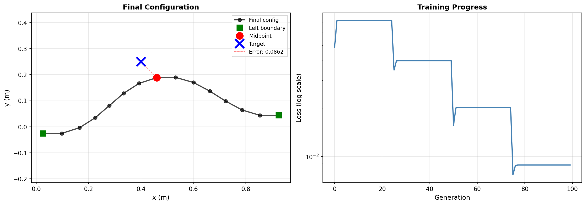

# Neural Control

A minimal, self-contained implementation of **Neural Control**, a method for
controlling deformable linear objects (DLOs, e.g. elastic rods/strips) whose
state is defined *implicitly* by an equilibrium condition (`G(x, z) = 0`)
rather than an explicit forward dynamics model.

This branch (`neural-control-core`) contains only the core method: the
equilibrium simulator, the adjoint gradient tools, and the training scripts
needed to reproduce the paper's point-to-point and trajectory-tracking
tasks.

## How it works

Instead of unrolling the Newton-Raphson equilibrium solver to get gradients
(expensive), Neural Control differentiates the equilibrium condition itself
at the converged solution ("implicit adjoint" gradients), then trains a
boundary-actuation controller with those gradients:

1. **`src/SimulatorEnv_2D.py` / `src/SimulatorEnv_3D.py`** — simulate the rod
   by solving for its equilibrium at each timestep, warm-started from the
   previous step so the solver stays on one equilibrium branch instead of
   jumping between them. Pick one with `env.dim` in the config (see
   [2D vs. 3D](#2d-vs-3d)).
2. **`src/implicit_grad_tools.py`** — computes the adjoint gradient of the
   loss w.r.t. the controls, and chains per-step sensitivities across the
   whole horizon (`multistep_adjoint_gradient()`) so every control step gets
   credit/blame proportional to its own equilibrium Jacobian.
3. **Controller** — maps a continuation parameter `λ ∈ [0, 1]` (progress
   through the control horizon) to boundary actuation rates. Two options:
   - MLP, trained with adjoint gradients (`train_adjoint.py`, `train_tracking.py`)
   - low-order polynomial, trained gradient-free with CMA-ES
     (`train_cmaes.py`) — simpler and the recommended starting point.
4. **Receding-horizon control (RHC)** — optional (`rhc.enabled` in
   `configs/default.yaml`). Splits the horizon into shorter segments,
   optimized and committed one at a time, warm-started from the previous
   segment's end state. Bounds error accumulation over long horizons.
   `train_cmaes.py` always uses this scheme.

## Repository layout

```
neural-control/
├── configs/
│   └── default.yaml            # Global config: rod/task/start pose/RHC/training params
├── src/
│   ├── SimulatorEnv_2D.py      # Equilibrium (Newton-Raphson) rod simulator, 2D
│   ├── SimulatorEnv_3D.py      # Equilibrium (Newton-Raphson) rod simulator, 3D
│   ├── energy.py               # Pluggable elastic-energy models (der, der3d, der3d_twist)
│   ├── rodframes.py            # Material frames + reference twist (torsion)
│   ├── contact.py              # Penalty-based obstacle contact forces (Circle/Sphere)
│   ├── implicit_grad_tools.py  # Adjoint / implicit-gradient computation (2D and 3D)
│   ├── env_factory.py          # dim-aware env/control/target construction
│   ├── config.py               # YAML config loader (deep-merges onto configs/default.yaml)
│   ├── render_neurips.py       # DLO rendering utilities (2D)
│   └── utils.py                # Result visualization
├── scripts/
│   ├── train_cmaes.py          # Task 1: point-to-point, CMA-ES controller (recommended)
│   ├── train_adjoint.py        # Task 1: point-to-point, adjoint-gradient MLP controller
│   ├── train_tracking.py       # Task 2: trajectory tracking, adjoint-gradient MLP controller
│   ├── check_twist.py          # Finite-difference validation of the torsion model
│   ├── snapshot_overlay.py     # Multi-frame DLO configuration visualization
│   └── test_gpu.py             # MPS/GPU availability check
├── img/                        # README figures
└── outputs/                    # Generated figures (created at runtime)
    ├── neural_control_result.png     # final shape + loss curve
    └── neural_control_animation.gif  # rollout animation (output.save_gif: true)
```

## Choosing a rod material

`configs/default.yaml` carries a `materials:` registry of cross-section /
material presets; `rod.material` picks one:

| preset | EI (1 m rod) | ν | GJ (twist) | notes |
|---|---|---|---|---|
| `steel_tube` | 2.19e+3 N·m² | 0.30 | 1.68e+3 N·m² | stiff extreme, slow solves |
| `aluminum_tube` | 7.65e+2 N·m² | 0.33 | 5.75e+2 N·m² | the original default |
| `soft_strip` | 1.27e-1 N·m² | 0.40 | 9.09e-2 N·m² | thin polymer strip — fast, visibly deforms |
| `silicone_cord` | 2.45e-3 N·m² | 0.49 | 1.65e-3 N·m² | cable-like, gravity-dominated |

```yaml
rod:
  material: soft_strip
```

A preset sets `R_outer`, `r_inner`, `E_al`, `rho_al` and `poisson`; everything
else (I, A, EI, EA, GJ, nodal mass) is derived from those. Any of them can
still be overridden directly under `rod:`, which wins over the preset:

```yaml
rod:
  material: aluminum_tube
  r_inner: 0.012       # same material, thinner wall
```

`poisson` is only used when `rod.twist` is on: for the circular cross-section
`J = 2I` and `G = E / (2(1+ν))`, so the torsional stiffness is
**`GJ = EI / (1 + ν)`**. It is a property of the material rather than a solver
setting, which is why it lives in the preset — aluminium, nylon, steel and
silicone genuinely differ, and the resulting `GJ/EI` ranges from 0.67
(silicone) to 0.77 (steel). Omitting it defaults to 0.3.

Use `material: custom` to skip the presets and give the four required fields
yourself (`poisson` stays optional). To add a preset, append an entry under
`materials:` and point `rod.material` at it. Each run prints the resolved
material and its EI/EA, plus GJ when twist is on.

Note that EI scales with the *fourth* power of the radius, so the cross-section
usually matters more than the material. A stiff rod barely deforms under the
boundary control and its Newton solve needs many more line-search steps —
`soft_strip` is the fastest preset to iterate with.

## Setup

```bash
conda env create -f requirement.yml
conda activate neural-control
```

or install directly with pip: `numpy`, `matplotlib`, `tqdm`, `torch`,
`tensorboard`, `cma`, `pyyaml`.

## Configuration

All three training scripts are driven by a single YAML config,
[`configs/default.yaml`](configs/default.yaml). Edit it directly, or pass
`--config path/to/your.yaml` with a file that only overrides the fields you
care about (deep-merged onto the defaults). Key sections:

- `env` — `dim: 2` or `dim: 3`, i.e. which simulator to use
- `rod` — physical/geometric parameters (node count, timestep, horizon, material,
  and `gravity` in 3D)
- `energy` — elastic energy model (built-in DER, or your own; see `src/energy.py`)
- `start` — initial boundary pose for both rod ends
- `task` — task type (`point_to_point` / `tracking`) and target/trajectory
- `newton` — equilibrium-solver safeguards (line search, regularization); see
  [Newton convergence](#newton-convergence)
- `rhc` — whether to use receding-horizon control, segment count, re-init policy
- `train` — epochs, learning rate, network width, seed, device

## 2D vs. 3D

Set `env.dim` in the config; all three training scripts, the adjoint
gradients, contact, and the plots follow it.

|                     | `dim: 2`                 | `dim: 3`                       | `dim: 3` + `rod.twist`                |
| ------------------- | ------------------------ | ------------------------------ | ------------------------------------- |
| simulator           | `SimulatorEnv_2D`        | `SimulatorEnv_3D`              | `SimulatorEnv_3D`                     |
| DOFs                | `2·nv`                   | `3·nv`                         | `4·nv − 1` (+1 twist angle per edge)  |
| control per rod end | `(x, y, θ)`              | `(x, y, z, θ, φ)`              | `(x, y, z, θ, φ, yaw)`                |
| full control vector | 6D                       | 10D                            | 12D                                   |
| elastic energy      | `der`                    | `der3d`                        | `der3d_twist`                         |
| obstacles           | `CircleObstacle`         | `SphereObstacle`               | `SphereObstacle`                      |
| target / trajectory | `task.target_xy`         | `task.target_xyz`              | `task.target_xyz`                     |
| initial end poses   | `start.u_left`/`u_right` | `start.u_left_3d`/`u_right_3d` | `start.u_left_twist`/`u_right_twist`  |

Both rod ends are **clamped**: the control prescribes each end's position and
its tangent direction. In 3D the tangent needs two angles instead of one —
azimuth `θ` in the x-y plane and elevation `φ` out of it:

```
d(θ, φ) = ( cos φ · cos θ,  cos φ · sin θ,  sin φ )
```

so `φ = 0` reproduces the 2D convention exactly. The two clamped nodes at each
end are `node_0 = p_l`, `node_1 = p_l + ΔL·d(θ_l, φ_l)` and symmetrically at the
right end.

The 3D elastic energy (`der3d` in `src/energy.py`) is the Discrete Elastic Rod
model for a naturally straight rod: per-edge stretching springs plus isotropic
bending `E_b = Σ (EI / 2ΔL)·|κb|²`. Because the rod is naturally straight and
bending is isotropic, `|κb|²` reduces to a function of the single scalar
`c = t_e · t_f`, which is what makes the *exact* Hessian — required by the
adjoint gradient — cheap to write in closed form.

Torsion is off by default and enabled with `rod.twist: true`; see
[Torsion and gripper yaw](#torsion-and-gripper-yaw).

Gravity in 3D is the config vector `rod.gravity`, defaulting to
`[0, -9.81, 0]` so that y stays "down" as in 2D. With that default, a 3D run
confined to `z = 0` and `φ = 0` reproduces the 2D run node for node (verified
to machine precision). Use `[0, 0, -9.81]` for the usual z-up convention.

Tracking trajectories: `circle`, `figure8` and `line` work in both dims (the
planar curves sit at `z = 0` in 3D); `helix` and `figure8_3d` are 3D-only.

`scripts/snapshot_overlay.py` and `src/render_neurips.py` remain 2D-only.

## Performance

The dominant per-step cost is the dense solve `J_ff \ f_free`, where
`n_free = dim*nv - 4*dim` — **94** for the 2D default (nv=51) and **141** for
the 3D one. That 1.5x growth in DOFs is not what makes 3D slow. OpenBLAS
switches from its serial kernel to a threaded one at about n = 100, and for
matrices this small the thread spawn/sync overhead dwarfs the factorization.
Measured on a 16-core machine:

| solve size | default threads | `OPENBLAS_NUM_THREADS=1` |
| ---------- | --------------- | ------------------------ |
| 94 x 94 (2D default)  | 0.057 ms   | 0.057 ms |
| 100 x 100             | **96.4 ms**| 0.063 ms |
| 141 x 141 (3D default)| **260.8 ms**| 0.127 ms |
| 256 x 256             | 604.8 ms   | 0.615 ms |

2D lands just under the threshold and 3D just over it, so 3D paid a ~2000x
penalty on its single hottest operation. The training scripts therefore call
`limit_blas_threads()` ([`src/blas_threads.py`](src/blas_threads.py)) before
importing NumPy. Real effect, 2 epochs of the default 3D config
(nv=51, N=200): **396 s -> 22 s, ~18x**.

The variables are set with `setdefault`, so the shell always wins if you want
something else:

```bash
OPENBLAS_NUM_THREADS=4 python scripts/train_adjoint.py --config configs/example_3d.yaml
```

If you drive the simulator from your own script rather than `scripts/train_*.py`,
do the same thing before NumPy loads:

```python
import sys; sys.path.insert(0, 'src')
from blas_threads import limit_blas_threads
limit_blas_threads()
import numpy as np          # only now
```

After that fix the bottleneck is the **Python-loop assembly** of the elastic
force and Hessian (~8.6 ms per call in 3D, ~18.3 ms in 2D), at ~10 Newton
iterations per step. Vectorizing those stencil loops — not a faster linear
solver — is the next worthwhile optimization; the Hessian is banded (only
2.8% nonzero in 3D), so a banded solver would help only for much larger `nv`.

## Newton convergence

If training prints a stream of `Maximum number of iterations reached.`, the
per-step equilibrium solve is diverging. The cause is almost always the same:
a **compressed rod is post-buckled**, so the equilibrium Jacobian `J_ff` has
negative eigenvalues (one pair per buckling mode — and 3D has twice as many as
2D, because every mode exists in both the y and the z direction). An undamped
full Newton step on an indefinite system can increase the residual without
bound; in practice it runs away from ~1e0 to ~1e18 in a few iterations, burns
all `rod.max_newton_iter` iterations, and prints that message.

The solver in [`src/newton.py`](src/newton.py) is globalized against this:

1. **backtracking line search** — the full Newton step is always tried first
   and only halved if it fails to reduce `||residual||`;
2. **adaptive Tikhonov regularization** — if no step length helps, `J_ff` is
   shifted by `λ·scale·I` with λ escalating, bending the step toward gradient
   descent; λ relaxes again on success.

Neither changes the answer when plain Newton was already converging (verified
bit-identical, ~1e-16). Where plain Newton diverged, the difference is
decisive — one 2D compression case returns a rod of arc length 3.5×10⁶ (i.e.
garbage) undamped, and the correct arc length 0.998 with the line search on.

Knobs (`newton:` in the config):

```yaml
newton:
  line_search: true    # false -> exactly the original undamped iteration
  max_backtrack: 12
  reg: 0.0             # raise to ~1e-8 for a persistently unstable setup
  verbose: false       # one-line diagnosis (residual, iterations, reason) per failed step
```

`env.n_newton_failures` counts non-converged steps, and `info["newton"]` from
`env.step()` carries the per-step residual, iteration count and failure reason.

If failures persist after this, the physics — not the solver — is the problem.
Check in this order: the control is compressing the rod far past buckling
(shorten the travel or raise `rod.total_time` so each step moves less); the
rod is too stiff for the step size (`rod.E_al`, `rod.R_outer`); or the target
is simply unreachable, so the policy drives the ends to extremes.

## Usage

Run everything from the `neural-control/` directory.

```bash
# Task 1: point-to-point boundary control (CMA-ES, recommended entry point)
python scripts/train_cmaes.py

# Task 1: point-to-point, full adjoint-gradient training
python scripts/train_adjoint.py

# Task 2: trajectory tracking (circle/figure8/line, set in configs/default.yaml)
python scripts/train_tracking.py

# Any of the above in 3D: set `env: {dim: 3}` in your config
python scripts/train_adjoint.py --config configs/my_3d_experiment.yaml

# Any of the above with a custom config
python scripts/train_adjoint.py --config configs/my_experiment.yaml

# Visualize a resulting trajectory as overlaid snapshots
python scripts/snapshot_overlay.py --traj circle
```

Programmatic usage (mirrors `train_cmaes.py`):

```python
import sys; sys.path.insert(0, 'src')
import numpy as np
from SimulatorEnv_2D import SimulatorEnv_2D
from scripts.train_cmaes import NeuralControlAgent

env = SimulatorEnv_2D(nv=15, dt=0.01, rod_length=1.0, total_time=1.0)
agent = NeuralControlAgent(env, segment_horizon=6, degree=3)
target_pos = np.array([0.5, 0.2])

results = agent.run_rhc(
    target_pos=target_pos,
    n_segments=4,
    n_iterations_per_segment=25,
)
```

The same in 3D — only the env class, the control width and the target change:

```python
from SimulatorEnv_3D import SimulatorEnv_3D

env = SimulatorEnv_3D(nv=15, dt=0.01, rod_length=1.0, total_time=1.0)
agent = NeuralControlAgent(env, segment_horizon=6, degree=3)   # picks up env.dim
results = agent.run_rhc(target_pos=np.array([0.5, 0.2, 0.1]), n_segments=4,
                        n_iterations_per_segment=25)
```

## Example result

Task 1 (point-to-point): elastic strip with 15 nodes, midpoint driven from
`(0.50, 0.00)` to target `(0.50, 0.20)` via CMA-ES + RHC, 4 segments × 25
iterations, final tracking error ≈ 0.0227 m.



### Animating the rollout

All three training scripts can additionally write the whole committed control
rollout as a GIF, `outputs/neural_control_animation.gif` — the rod frame by
frame over the full horizon, with the midpoint, the path it has traced so far
and the target (for tracking, the target curve plus the current target point).
It is off by default because rendering costs a few seconds; enable it in
`configs/default.yaml`:

```yaml
output:
  save_gif: true
  gif_fps: 20            # playback speed
  gif_dpi: 100           # resolution
  gif_max_frames: 200    # longer rollouts are subsampled evenly
```

In RHC mode the per-segment rollouts are concatenated, so the animation covers
the whole horizon rather than the last segment.

## Notes vs. the paper

- `train_cmaes.py` uses CMA-ES rather than the paper's analytical adjoint —
  simplest way to reproduce the qualitative result with no per-task gradient
  derivation. `train_adjoint.py` and `train_tracking.py` use the actual
  adjoint gradients.
- The demo simulator uses `nv` nodes (`configs/default.yaml`, `rod.nv`)
  rather than the paper's 101, for faster iteration.

## Torsion and gripper yaw

`rod.twist: true` gives the rod a third rotational freedom at each end and lets
it actually twist. Without it the gripper can only *aim* its tangent — two
angles, azimuth `θ` and elevation `φ` — and the spin about that tangent has
nowhere to live.

### What gets added

Following the Discrete Elastic Rod construction (Bergou et al.; the same one
[DEFORM](https://roahmlab.github.io/DEFORM/) uses), every edge carries a
**material frame**, split into a *reference director* moved by twist-free
parallel transport plus a scalar **twist angle** `θⁱ`. Those angles are real
degrees of freedom, so the DOF vector grows:

```
q = [ x₀ y₀ z₀ … x_{nv-1} y_{nv-1} z_{nv-1} | θ⁰ … θ^{nv-2} ]
    \______________ 3·nv positions ________/ \__ nv−1 twists __/
```

The energy gains a twisting term:

```
E = E_stretch(x) + E_bend(x) + E_twist(x, θ)
E_twist = Σᵢ (GJ / 2ΔL) · mᵢ² ,   mᵢ = θⁱ − θⁱ⁻¹ + ψᵢ(x)
```

with `GJ = EI / (1 + ν)` for a circular cross-section. `ν` comes from the rod's
material preset (see [Choosing a rod material](#choosing-a-rod-material)), so
switching material changes bending and torsional stiffness together.

### Why `ψ` is the whole point

`ψᵢ` is the **reference twist**: parallel transport along the rod is not
integrable, so carrying the director from edge `i−1` onto edge `i` does not
land on edge `i`'s own director, and `ψᵢ` is the gap. It depends on the
*positions*, and that is exactly what couples twisting to bending — the
discrete form of link = twist + writhe.

Drop it and `E_twist` would depend on `θ` alone: the rod would twist, its
centreline would not move, and `dL/d(yaw)` for any position-based loss would be
**identically zero** — a dead control input. With it, `dL/d(yaw)` is nonzero
and the policy can actually learn to use yaw.

### Yaw

Yaw is measured from that edge's reference director. Because the reference
frame is carried by twist-free parallel transport between steps, holding yaw
constant means applying no twist and changing it twists the rod — so the
control maps onto the clamped twist angles directly, with no geometry in
between (`boundary_node_jacobian_3d_twist` is the 12-row position map plus two
rows that are a single `1`).

### Seeing it

With `output.save_gif` on, a twisting run's animation also draws the
**cross-section orientation** at the two ends and the midpoint — three arrows
each: the edge tangent (grey) and the two material axes `m1` (orange) and `m2`
(green). Those are what yaw actually turns, and watching them is the quickest
way to tell twisting apart from bending: `m1`/`m2` spinning about a tangent
that is not moving means pure torsion, while the rod buckling into an S means
the twist has converted into writhe.

The reference directors are simulator state rather than something `q` carries,
so the plotting code replays them along the recorded configurations instead of
requiring the training scripts to record them. Nothing is drawn without
`rod.twist` — a twist-free rod has no material frame to show.

### Correctness

Everything the adjoint depends on is finite-difference checked by
`python scripts/check_twist.py` (9/9 at the time of writing):

| check | error |
| --- | --- |
| `grad(ψ)` | 3.7e-09 |
| `hess(ψ)` | 8.4e-07 |
| twisting energy force / Jacobian | ~7e-11 |
| `GJ = 0` reduces to `der3d` | exactly 0 |
| boundary map `d(q_b)/d(u)`, 14×12 | 5.3e-10 |
| adjoint `dL/du` incl. yaw | 6.8e-08 |

Two things that cost real debugging time, recorded so they are not rediscovered:

- **`hess(ψ)` is the *symmetric part* of the chain-rule matrix.** Differentiating
  the `kb/2L` gradient expression directly gives a matrix carrying a spurious
  antisymmetric piece; the raw version is off by >100%.
- **`grad(ψ)` has a re-adaptation term** beyond the classical holonomy, from
  carrying each stored director onto the current tangent. It vanishes when the
  stored tangents equal the current ones, so it is invisible at the start of a
  step and only appears once the Newton iterate has moved — dropping it costs
  ~50% of the gradient.

One approximation is left, and it is the same class the horizon adjoint already
makes: the reference frames advance once a step is committed, so a perturbed
control follows a slightly different frame path that the single-step implicit
gradient does not see. `check_twist.py` measures it at ~6.5e-04 relative over a
3-step rollout.

### What is still not modelled

Anisotropic bending (different stiffness about the two cross-section axes) and
non-zero natural curvature or natural twist. Both would need the bending term
rewritten against the material frame; the twist machinery is already in place.

## Limits of the 3D model

The end-effector orientation is parameterized as `(θ, φ, yaw)`. That is three
angles, so it does cover the full rotation group, but like any Euler-style
chart it degenerates: at `φ = ±π/2` the tangent points along `z` and `θ` and
`yaw` become the same rotation (gimbal lock). Trajectories that drive an end
near vertical should switch to axis-angle or quaternions.
