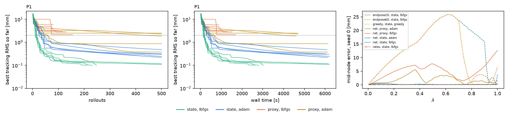

# 3D path tracking with contact (task P)

Solved: tracking RMS of the mid node over all steps <= solve_rms and the motion admissible (every step converged and stable, NO snap-through flagged, every pose in the workspace, max penetration <= train.max_penetration, no cap or self-contact). 'rollouts' counts every rollout, failed ones and line-search trials included; 'snap rej.' the trials rejected by the snap rule.

| target | param | gradient | optimizer | seed | init rms [mm] | final rms [mm] | final max [mm] | end err [mm] | on peg [%] | solved | updates | rollouts | failed | snap rej. | max pen. [mm] | time [s] | stop |
|---|---|---|---|---|---|---|---|---|---|---|---|---|---|---|---|---|---|
| P1 | endpose20 | state | lbfgs | 0 | 17.403 | 16.892 | 25.810 | 3.946 | 32 | no | 109 | 500 | 1 | 0 | 0.000 | 5640 | rollout budget (500) used |
| P1 | endpose20 | state | lbfgs | 1 | 15.771 | 15.672 | 24.561 | 2.093 | 70 | no | 119 | 500 | 0 | 0 | 0.027 | 6462 | rollout budget (500) used |
| P1 | endpose20 | state | lbfgs | 2 | 17.185 | 17.140 | 27.466 | 1.876 | 34 | no | 117 | 500 | 1 | 0 | 0.000 | 5700 | rollout budget (500) used |
| P1 | endpose20 | state | lbfgs | 3 | 15.985 | 15.852 | 25.284 | 1.624 | 32 | no | 152 | 500 | 0 | 0 | 0.000 | 5531 | rollout budget (500) used |
| P1 | endpose20 | state | lbfgs | 4 | 16.512 | 16.411 | 26.344 | 2.277 | 38 | no | 96 | 224 | 0 | 0 | 0.000 | 2509 | line search found no admissible decrease |
| P1 | endpose60 | state | lbfgs | 0 | 17.403 | 14.776 | 25.810 | 6.646 | 24 | no | 122 | 500 | 3 | 0 | 0.000 | 5358 | rollout budget (500) used |
| P1 | endpose60 | state | lbfgs | 1 | 15.771 | 15.464 | 24.561 | 7.430 | 76 | no | 80 | 207 | 0 | 0 | 0.027 | 2438 | line search found no admissible decrease |
| P1 | endpose60 | state | lbfgs | 2 | 17.185 | 16.099 | 27.466 | 6.095 | 26 | no | 59 | 86 | 20 | 0 | 0.000 | 930 | 20 failed rollouts (last: workspace (+0.00325)) |
| P1 | endpose60 | state | lbfgs | 3 | 15.985 | 15.257 | 25.284 | 5.087 | 26 | no | 100 | 336 | 0 | 0 | 0.000 | 3635 | line search found no admissible decrease |
| P1 | endpose60 | state | lbfgs | 4 | 16.512 | 15.212 | 26.344 | 6.143 | 26 | no | 110 | 286 | 1 | 0 | 0.000 | 3024 | line search found no admissible decrease |
| P1 | greedy | state | greedy | 0 | - | 0.028 | 0.122 | 0.033 | 63 | yes | 200 | 4 | 0 | 0 | 0.002 | 32 | end of the path |
| P1 | net | proxy | adam | 0 | 17.408 | 2.291 | 5.570 | 1.675 | 6 | no | 499 | 500 | 0 | 0 | 0.000 | 4682 | rollout budget (500) used |
| P1 | net | proxy | adam | 1 | 15.771 | 0.964 | 1.969 | 0.858 | 68 | yes | 499 | 500 | 0 | 0 | 0.025 | 6133 | rollout budget (500) used |
| P1 | net | proxy | adam | 2 | 17.184 | 1.862 | 4.806 | 1.931 | 0 | yes | 499 | 500 | 0 | 0 | 0.000 | 4601 | rollout budget (500) used |
| P1 | net | proxy | adam | 3 | 15.987 | 0.572 | 0.791 | 0.571 | 63 | yes | 499 | 500 | 0 | 0 | 0.000 | 6124 | rollout budget (500) used |
| P1 | net | proxy | adam | 4 | 16.514 | 2.725 | 5.956 | 0.821 | 0 | no | 499 | 500 | 0 | 0 | 0.000 | 4699 | rollout budget (500) used |
| P1 | net | proxy | lbfgs | 0 | 17.408 | 5.716 | 12.671 | 12.671 | 40 | no | 6 | 80 | 2 | 0 | 0.000 | 881 | line search found no admissible decrease |
| P1 | net | proxy | lbfgs | 1 | 15.771 | 2.827 | 4.937 | 4.937 | 47 | no | 22 | 130 | 0 | 0 | 0.000 | 1519 | line search found no admissible decrease |
| P1 | net | proxy | lbfgs | 2 | 17.184 | 3.307 | 6.066 | 6.066 | 38 | no | 18 | 101 | 0 | 0 | 0.000 | 1055 | line search found no admissible decrease |
| P1 | net | proxy | lbfgs | 3 | 15.987 | 2.129 | 5.262 | 5.262 | 54 | no | 15 | 155 | 1 | 0 | 0.000 | 1697 | line search found no admissible decrease |
| P1 | net | proxy | lbfgs | 4 | 16.514 | 2.920 | 5.926 | 5.926 | 44 | no | 17 | 116 | 0 | 0 | 0.000 | 1277 | line search found no admissible decrease |
| P1 | net | state | adam | 0 | 17.408 | 0.219 | 0.506 | 0.386 | 64 | yes | 499 | 500 | 0 | 0 | 0.000 | 6115 | rollout budget (500) used |
| P1 | net | state | adam | 1 | 15.771 | 0.479 | 0.837 | 0.450 | 64 | yes | 499 | 500 | 0 | 0 | 0.003 | 6097 | rollout budget (500) used |
| P1 | net | state | adam | 2 | 17.184 | 0.316 | 0.720 | 0.720 | 64 | yes | 499 | 500 | 0 | 0 | 0.006 | 6030 | rollout budget (500) used |
| P1 | net | state | adam | 3 | 15.987 | 0.300 | 0.735 | 0.735 | 64 | yes | 499 | 500 | 0 | 0 | 0.003 | 6186 | rollout budget (500) used |
| P1 | net | state | adam | 4 | 16.514 | 0.245 | 0.580 | 0.580 | 64 | yes | 499 | 500 | 0 | 0 | 0.000 | 6212 | rollout budget (500) used |
| P1 | net | state | lbfgs | 0 | 17.408 | 0.109 | 0.210 | 0.115 | 64 | yes | 417 | 500 | 2 | 0 | 0.000 | 6209 | rollout budget (500) used |
| P1 | net | state | lbfgs | 1 | 15.771 | 0.099 | 0.300 | 0.300 | 64 | yes | 214 | 248 | 0 | 0 | 0.000 | 3027 | rms 0.0990 mm <= stop_rms 0.1 mm |
| P1 | net | state | lbfgs | 2 | 17.184 | 0.099 | 0.227 | 0.227 | 64 | yes | 200 | 231 | 1 | 0 | 0.000 | 2802 | rms 0.0993 mm <= stop_rms 0.1 mm |
| P1 | net | state | lbfgs | 3 | 15.987 | 0.100 | 0.263 | 0.263 | 62 | yes | 171 | 212 | 1 | 0 | 0.000 | 2600 | rms 0.1000 mm <= stop_rms 0.1 mm |
| P1 | net | state | lbfgs | 4 | 16.514 | 0.117 | 0.216 | 0.139 | 64 | yes | 423 | 500 | 1 | 0 | 0.000 | 6163 | rollout budget (500) used |
| P1 | rates | state | lbfgs | 0 | 17.403 | 0.096 | 0.476 | 0.476 | 64 | yes | 19 | 27 | 0 | 0 | 0.000 | 321 | rms 0.0959 mm <= stop_rms 0.1 mm |
| P1 | rates | state | lbfgs | 1 | 15.771 | 0.096 | 0.340 | 0.340 | 64 | yes | 39 | 50 | 0 | 0 | 0.000 | 611 | rms 0.0956 mm <= stop_rms 0.1 mm |
| P1 | rates | state | lbfgs | 2 | 17.185 | 0.090 | 0.383 | 0.383 | 64 | yes | 28 | 36 | 0 | 0 | 0.004 | 430 | rms 0.0901 mm <= stop_rms 0.1 mm |
| P1 | rates | state | lbfgs | 3 | 15.985 | 0.100 | 0.502 | 0.502 | 64 | yes | 40 | 51 | 0 | 0 | 0.001 | 616 | rms 0.0998 mm <= stop_rms 0.1 mm |
| P1 | rates | state | lbfgs | 4 | 16.512 | 0.100 | 0.369 | 0.369 | 64 | yes | 34 | 43 | 0 | 0 | 0.000 | 524 | rms 0.0996 mm <= stop_rms 0.1 mm |

## Per method

| param | gradient | optimizer | runs | solved | median final rms [mm] | median rollouts | failed rollouts (total) | snap rejections (total) |
|---|---|---|---|---|---|---|---|---|
| endpose20 | state | lbfgs | 5 | 0 | 16.411 | 500 | 2 | 0 |
| endpose60 | state | lbfgs | 5 | 0 | 15.257 | 286 | 24 | 0 |
| greedy | state | greedy | 1 | 1 | 0.028 | 4 | 0 | 0 |
| net | proxy | adam | 5 | 3 | 1.862 | 500 | 0 | 0 |
| net | proxy | lbfgs | 5 | 0 | 2.920 | 116 | 3 | 0 |
| net | state | adam | 5 | 5 | 0.300 | 500 | 0 | 0 |
| net | state | lbfgs | 5 | 5 | 0.100 | 248 | 5 | 0 |
| rates | state | lbfgs | 5 | 5 | 0.096 | 43 | 0 | 0 |

