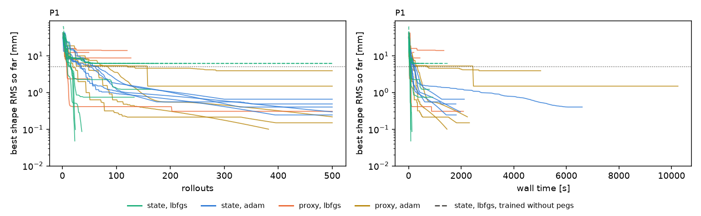

# 3D shape formation against two pegs

Solved: final shape RMS <= solve_rms and the motion admissible (every step converged and stable, every pose in the workspace, max penetration <= train.max_penetration, no cap contact). 'rollouts' counts every rollout, failed ones and line-search trials included.

| target | param | gradient | optimizer | seed | init rms [mm] | final rms [mm] | best rms [mm] | solved | updates | rollouts | failed | snaps (final) | max pen. [mm] | time [s] | stop |
|---|---|---|---|---|---|---|---|---|---|---|---|---|---|---|---|
| P1 | endpose20 | state | lbfgs | 0 | 32.511 | 0.064 | 0.064 | yes | 58 | 70 | 0 | 0 | 0.123 | 245 | rms 0.0643 mm <= stop_rms 0.1 mm |
| P1 | endpose20 | state | lbfgs | 1 | 41.902 | 0.065 | 0.065 | yes | 22 | 32 | 0 | 0 | 0.133 | 128 | rms 0.0646 mm <= stop_rms 0.1 mm |
| P1 | endpose20 | state | lbfgs | 2 | 30.322 | 0.671 | 0.671 | yes | 32 | 199 | 0 | 1 | 0.120 | 1495 | line search found no admissible decrease |
| P1 | endpose20 | state | lbfgs | 3 | 38.348 | 0.078 | 0.078 | yes | 30 | 36 | 0 | 0 | 0.123 | 137 | rms 0.0782 mm <= stop_rms 0.1 mm |
| P1 | endpose20 | state | lbfgs | 4 | 41.896 | 1.562 | 1.562 | yes | 41 | 500 | 0 | 0 | 0.126 | 2361 | rollout budget (500) used |
| P1 | endpose20aimed | state | none | 0 | 0.000 | 0.000 | 0.000 | yes | 0 | 1 | 0 | 0 | 0.123 | 4 | rms 0.0000 mm <= stop_rms 0.1 mm |
| P1 | endpose20aimed | state | none | 1 | 0.000 | 0.000 | 0.000 | yes | 0 | 1 | 0 | 0 | 0.132 | 4 | rms 0.0001 mm <= stop_rms 0.1 mm |
| P1 | endpose20aimed | state | none | 2 | 76.036 | 76.036 | 76.036 | no | 0 | 1 | 0 | 0 | 0.111 | 4 | no optimization (evaluation only) |
| P1 | endpose20aimed | state | none | 3 | 0.000 | 0.000 | 0.000 | yes | 0 | 1 | 0 | 0 | 0.122 | 4 | rms 0.0000 mm <= stop_rms 0.1 mm |
| P1 | endpose20aimed | state | none | 4 | 0.000 | 0.000 | 0.000 | yes | 0 | 1 | 0 | 0 | 0.127 | 4 | rms 0.0000 mm <= stop_rms 0.1 mm |
| P1 | endpose60 | state | lbfgs | 0 | 32.511 | 0.092 | 0.092 | yes | 45 | 56 | 0 | 0 | 0.125 | 203 | rms 0.0917 mm <= stop_rms 0.1 mm |
| P1 | endpose60 | state | lbfgs | 1 | 41.902 | 0.075 | 0.075 | yes | 21 | 33 | 0 | 0 | 0.133 | 127 | rms 0.0746 mm <= stop_rms 0.1 mm |
| P1 | endpose60 | state | lbfgs | 2 | 30.322 | 0.632 | 0.632 | yes | 32 | 120 | 0 | 1 | 0.115 | 1762 | line search found no admissible decrease |
| P1 | endpose60 | state | lbfgs | 3 | 38.348 | 0.078 | 0.078 | yes | 30 | 36 | 0 | 0 | 0.126 | 129 | rms 0.0783 mm <= stop_rms 0.1 mm |
| P1 | endpose60 | state | lbfgs | 4 | 41.896 | 2.371 | 2.371 | yes | 23 | 284 | 0 | 0 | 0.130 | 1997 | line search found no admissible decrease |
| P1 | endpose60aimed | state | none | 0 | 0.000 | 0.000 | 0.000 | yes | 0 | 1 | 0 | 0 | 0.124 | 4 | rms 0.0000 mm <= stop_rms 0.1 mm |
| P1 | endpose60aimed | state | none | 1 | 0.000 | 0.000 | 0.000 | yes | 0 | 1 | 0 | 0 | 0.132 | 4 | rms 0.0000 mm <= stop_rms 0.1 mm |
| P1 | endpose60aimed | state | none | 2 | 76.036 | 76.036 | 76.036 | no | 0 | 1 | 0 | 0 | 0.117 | 4 | no optimization (evaluation only) |
| P1 | endpose60aimed | state | none | 3 | 0.000 | 0.000 | 0.000 | yes | 0 | 1 | 0 | 0 | 0.125 | 4 | rms 0.0000 mm <= stop_rms 0.1 mm |
| P1 | endpose60aimed | state | none | 4 | 0.000 | 0.000 | 0.000 | yes | 0 | 1 | 0 | 0 | 0.130 | 5 | rms 0.0000 mm <= stop_rms 0.1 mm |
| P1 | greedy | state | greedy | 0 | 157.237 | 0.000 | 0.000 | yes | 169 | 5.07 | 6 | 0 | 0.128 | 14 | trust radius below step_min |
| P1 | net | proxy | adam | 0 | 32.521 | 3.553 | 0.149 | yes | 499 | 500 | 0 | 0 | 0.135 | 2314 | rollout budget (500) used |
| P1 | net | proxy | adam | 1 | 41.889 | 0.217 | 0.217 | yes | 499 | 500 | 0 | 0 | 0.141 | 2237 | rollout budget (500) used |
| P1 | net | proxy | adam | 2 | 30.339 | 116.018 | 1.488 | no | 499 | 500 | 0 | 0 | 0.148 | 10245 | rollout budget (500) used |
| P1 | net | proxy | adam | 3 | 38.358 | 0.100 | 0.100 | yes | 380 | 382 | 0 | 0 | 0.127 | 1460 | rms 0.0999 mm <= stop_rms 0.1 mm |
| P1 | net | proxy | adam | 4 | 41.855 | 5.834 | 3.906 | no | 499 | 500 | 0 | 0 | 0.128 | 5023 | rollout budget (500) used |
| P1 | net | proxy | lbfgs | 0 | 32.521 | 8.726 | 8.726 | no | 8 | 127 | 2 | 0 | 0.108 | 432 | line search found no admissible decrease |
| P1 | net | proxy | lbfgs | 1 | 41.889 | 0.306 | 0.306 | yes | 36 | 500 | 0 | 0 | 0.135 | 2087 | rollout budget (500) used |
| P1 | net | proxy | lbfgs | 2 | 30.339 | 13.906 | 13.906 | no | 6 | 120 | 6 | 1 | 0.118 | 1342 | line search found no admissible decrease |
| P1 | net | proxy | lbfgs | 3 | 38.358 | 2.350 | 2.350 | yes | 7 | 51 | 0 | 0 | 0.117 | 183 | line search found no admissible decrease |
| P1 | net | proxy | lbfgs | 4 | 41.855 | 12.339 | 12.339 | no | 7 | 49 | 1 | 0 | 0.135 | 199 | line search found no admissible decrease |
| P1 | net | state | adam | 0 | 32.521 | 1.575 | 0.486 | yes | 499 | 500 | 0 | 0 | 0.128 | 1800 | rollout budget (500) used |
| P1 | net | state | adam | 1 | 41.889 | 0.297 | 0.297 | yes | 499 | 500 | 0 | 0 | 0.129 | 1973 | rollout budget (500) used |
| P1 | net | state | adam | 2 | 30.339 | 8.300 | 0.401 | no | 499 | 500 | 0 | 0 | 0.090 | 6602 | rollout budget (500) used |
| P1 | net | state | adam | 3 | 38.358 | 0.972 | 0.244 | yes | 499 | 500 | 0 | 0 | 0.123 | 1813 | rollout budget (500) used |
| P1 | net | state | adam | 4 | 41.855 | 0.922 | 0.656 | yes | 499 | 500 | 0 | 0 | 0.127 | 2118 | rollout budget (500) used |
| P1 | net | state | lbfgs | 0 | 32.521 | 0.098 | 0.098 | yes | 19 | 24 | 2 | 0 | 0.134 | 82 | rms 0.0977 mm <= stop_rms 0.1 mm |
| P1 | net | state | lbfgs | 1 | 41.889 | 0.048 | 0.048 | yes | 17 | 23 | 0 | 0 | 0.133 | 84 | rms 0.0478 mm <= stop_rms 0.1 mm |
| P1 | net | state | lbfgs | 2 | 30.339 | 0.743 | 0.743 | yes | 26 | 133 | 0 | 1 | 0.121 | 920 | line search found no admissible decrease |
| P1 | net | state | lbfgs | 3 | 38.358 | 0.086 | 0.086 | yes | 29 | 36 | 0 | 0 | 0.127 | 128 | rms 0.0864 mm <= stop_rms 0.1 mm |
| P1 | net | state | lbfgs | 4 | 41.855 | 1.219 | 1.219 | yes | 31 | 163 | 1 | 0 | 0.129 | 792 | line search found no admissible decrease |
| P1 | net (no pegs) | state | lbfgs | 0 | 32.521 | 6.874 | 6.187 | no | 83 | 174 | 2 | 0 | 0.042 | 515 | line search found no admissible decrease |
| P1 | net (no pegs) | state | lbfgs | 1 | 41.889 | 6.874 | 6.187 | no | 58 | 143 | 1 | 0 | 0.106 | 381 | line search found no admissible decrease |
| P1 | net (no pegs) | state | lbfgs | 2 | 30.339 | 6.874 | 6.187 | no | 84 | 234 | 1 | 0 | 0.042 | 632 | line search found no admissible decrease |
| P1 | net (no pegs) | state | lbfgs | 3 | 38.358 | 6.874 | 6.187 | no | 96 | 500 | 5 | 0 | 0.042 | 1327 | rollout budget (500) used |
| P1 | net (no pegs) | state | lbfgs | 4 | 41.855 | 6.874 | 6.187 | no | 85 | 500 | 1 | 0 | 0.042 | 1490 | rollout budget (500) used |
| P1 | rates | state | lbfgs | 0 | 32.511 | 0.079 | 0.079 | yes | 49 | 58 | 0 | 0 | 0.131 | 207 | rms 0.0788 mm <= stop_rms 0.1 mm |
| P1 | rates | state | lbfgs | 1 | 41.902 | 0.087 | 0.087 | yes | 35 | 44 | 0 | 0 | 0.133 | 170 | rms 0.0871 mm <= stop_rms 0.1 mm |
| P1 | rates | state | lbfgs | 2 | 30.322 | 0.577 | 0.577 | yes | 28 | 232 | 0 | 1 | 0.121 | 1973 | line search found no admissible decrease |
| P1 | rates | state | lbfgs | 3 | 38.348 | 0.077 | 0.077 | yes | 32 | 37 | 0 | 0 | 0.126 | 137 | rms 0.0765 mm <= stop_rms 0.1 mm |
| P1 | rates | state | lbfgs | 4 | 41.896 | 2.182 | 2.182 | yes | 31 | 401 | 0 | 0 | 0.130 | 2618 | line search found no admissible decrease |

## Per method

| param | gradient | optimizer | runs | solved | median final rms [mm] | median rollouts | failed rollouts (total) |
|---|---|---|---|---|---|---|---|
| endpose20 | state | lbfgs | 5 | 5 | 0.078 | 70 | 0 |
| endpose20aimed | state | none | 5 | 4 | 0.000 | 1 | 0 |
| endpose60 | state | lbfgs | 5 | 5 | 0.092 | 56 | 0 |
| endpose60aimed | state | none | 5 | 4 | 0.000 | 1 | 0 |
| greedy | state | greedy | 1 | 1 | 0.000 | 5 | 6 |
| net | proxy | adam | 5 | 3 | 3.553 | 500 | 0 |
| net | proxy | lbfgs | 5 | 2 | 8.726 | 120 | 9 |
| net | state | adam | 5 | 4 | 0.972 | 500 | 0 |
| net | state | lbfgs | 5 | 5 | 0.098 | 36 | 3 |
| net (no pegs) | state | lbfgs | 5 | 0 | 6.874 | 234 | 10 |
| rates | state | lbfgs | 5 | 5 | 0.087 | 58 | 0 |

