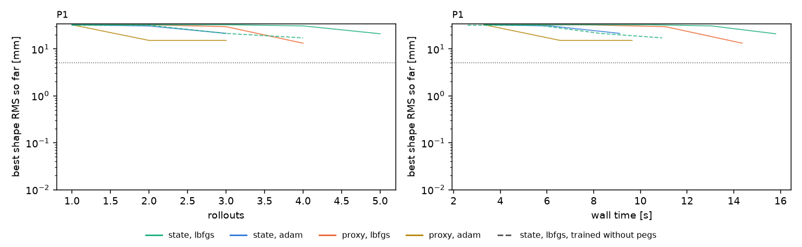

# 3D shape formation against two pegs

Solved: final shape RMS <= solve_rms and the motion admissible (every step converged and stable, every pose in the workspace, max penetration <= train.max_penetration, no cap contact). 'rollouts' counts every rollout, failed ones and line-search trials included.

| target | param | gradient | optimizer | seed | init rms [mm] | final rms [mm] | best rms [mm] | solved | updates | rollouts | failed | snaps (final) | max pen. [mm] | time [s] | stop |
|---|---|---|---|---|---|---|---|---|---|---|---|---|---|---|---|
| P1 | endpose20 | state | lbfgs | 0 | 32.511 | 27.026 | 27.026 | no | 2 | 4 | 0 | 0 | 0.060 | 12 | iteration cap (2) reached |
| P1 | endpose20aimed | state | none | 0 | 0.000 | 0.000 | 0.000 | yes | 0 | 1 | 0 | 0 | 0.123 | 3 | rms 0.0000 mm <= stop_rms 0.1 mm |
| P1 | endpose60 | state | lbfgs | 0 | 32.511 | 27.026 | 27.026 | no | 2 | 4 | 0 | 0 | 0.060 | 12 | iteration cap (2) reached |
| P1 | endpose60aimed | state | none | 0 | 0.000 | 0.000 | 0.000 | yes | 0 | 1 | 0 | 0 | 0.124 | 4 | rms 0.0000 mm <= stop_rms 0.1 mm |
| P1 | greedy | state | greedy | 0 | 157.237 | 155.171 | 155.171 | no | 2 | 0.06 | 0 | 0 | 0.000 | 0 | max_steps |
| P1 | net | proxy | adam | 0 | 32.509 | 17.014 | 15.106 | no | 2 | 3 | 0 | 0 | 0.120 | 10 | iteration cap (2) reached |
| P1 | net | proxy | lbfgs | 0 | 32.509 | 13.156 | 13.156 | no | 2 | 4 | 1 | 0 | 0.110 | 14 | iteration cap (2) reached |
| P1 | net | state | adam | 0 | 32.509 | 21.326 | 21.326 | no | 2 | 3 | 0 | 0 | 0.087 | 9 | iteration cap (2) reached |
| P1 | net | state | lbfgs | 0 | 32.509 | 20.919 | 20.919 | no | 2 | 5 | 0 | 0 | 0.000 | 16 | iteration cap (2) reached |
| P1 | net (no pegs) | state | lbfgs | 0 | 32.509 | 28.049 | 17.096 | no | 2 | 4 | 2 | 0 | 0.087 | 11 | iteration cap (2) reached |
| P1 | rates | state | lbfgs | 0 | 32.511 | 30.244 | 30.244 | no | 2 | 3 | 0 | 0 | 0.061 | 10 | iteration cap (2) reached |

## Per method

| param | gradient | optimizer | runs | solved | median final rms [mm] | median rollouts | failed rollouts (total) |
|---|---|---|---|---|---|---|---|
| endpose20 | state | lbfgs | 1 | 0 | 27.026 | 4 | 0 |
| endpose20aimed | state | none | 1 | 1 | 0.000 | 1 | 0 |
| endpose60 | state | lbfgs | 1 | 0 | 27.026 | 4 | 0 |
| endpose60aimed | state | none | 1 | 1 | 0.000 | 1 | 0 |
| greedy | state | greedy | 1 | 0 | 155.171 | 0 | 0 |
| net | proxy | adam | 1 | 0 | 17.014 | 3 | 0 |
| net | proxy | lbfgs | 1 | 0 | 13.156 | 4 | 1 |
| net | state | adam | 1 | 0 | 21.326 | 3 | 0 |
| net | state | lbfgs | 1 | 0 | 20.919 | 5 | 0 |
| net (no pegs) | state | lbfgs | 1 | 0 | 28.049 | 4 | 2 |
| rates | state | lbfgs | 1 | 0 | 30.244 | 3 | 0 |

